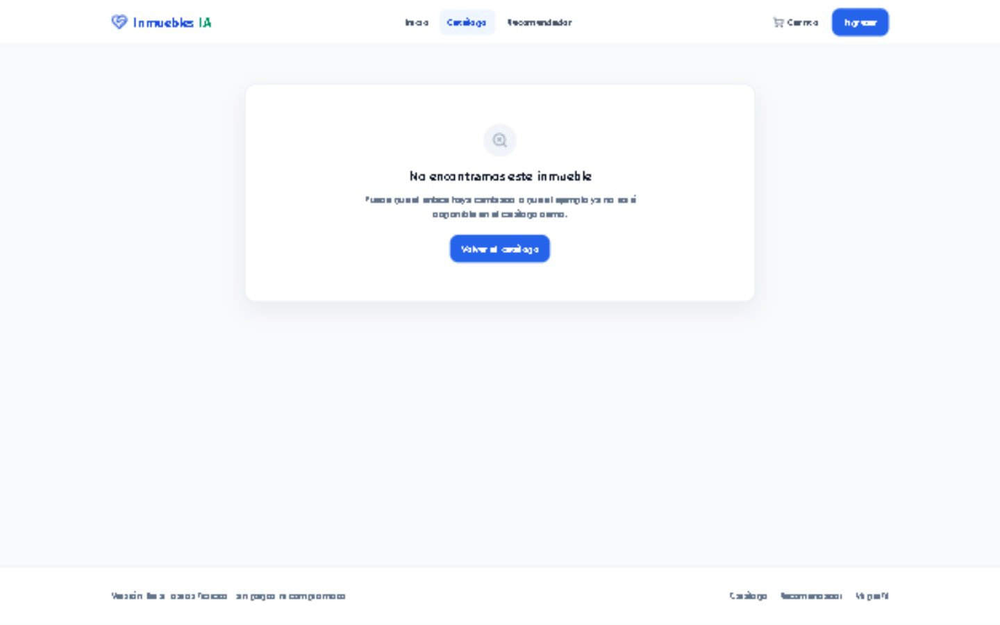

# Inmuebles IA — Recomendador inteligente de inmuebles


> **Encuentra tu próximo inmueble con criterio, no con ruido.**  
> 24 inmuebles ficticios de Lima, afinidad explicada de 0 a 100, carrito, visitas y preferencias que se guardan en tu navegador. Sin pagos ni compromisos.


---

## ¿Por qué ver este proyecto?

- **Funciona al instante:** `npm install` + `npm run dev`, sin `.env` ni bases de datos.
- **Recomendaciones que se explican:** cada inmueble dice por qué encaja contigo.
- **Demo completa:** registro, sesión, filtros, detalle, carrito, preferencias, visitas y perfil.
- **Persistencia real:** al recargar, tu cuenta y actividad siguen ahí (`localStorage`).
- **Preparado para crecer:** el mismo repositorio puede cambiar a Supabase solo con dos variables.
- **Interfaz responsive y sobria:** azul/verde, móvil primero y componentes accesibles.

## La app en acción

| Catálogo con filtros en vivo | Detalle con calculadora hipotecaria |
| :---: | :---: |
|  |  |

Otras pantallas: **recomendador** con puntaje de afinidad, **carrito** con totales agrupados por moneda (PEN/USD) y **perfil** con historial de interacciones.

## Empezar en 30 segundos

```bash
git clone https://github.com/mquiacno/Recomendador-Inmuebles.git
cd Recomendador-Inmuebles
npm install
npm run dev
```

Abre **http://localhost:3000**.

Para crear una cuenta en modo demo: **Regístrate** con cualquier correo y contraseña de 6+ caracteres. Todo se guarda solo en ese navegador.

```bash
npm run build     # compilación de producción
npm run preview   # vista previa del build
```

## Rutas

| Ruta | Descripción | Protegida |
| :--- | :--- | :---: |
| `/` | Inicio y búsqueda rápida | No |
| `/propiedades` | Catálogo: filtros en vivo, orden y paginación | No |
| `/propiedades/:id` | Galería, hipoteca, carrito, visita e “Investigar más” | No |
| `/recomendador` | Afinidad 0–100 con explicaciones y descartes | Sí |
| `/carrito` | Inmuebles guardados y totales por moneda | Sí |
| `/login` · `/registro` | Acceso demo / Supabase | No |
| `/perfil` | Preferencias, visitas e historial | Sí |

## Cómo piensa el recomendador

1. Parte de un **modo popularidad** si aún no hay preferencias.
2. Al guardar preferencias (presupuesto mínimo/máximo, distritos, tipo, dormitorios, mascotas y prioridades), calcula una **afinidad de 0 a 100**.
3. Ajusta el ranking con tus interacciones: vistas, carrito, visitas y “No me interesa”.
4. Explica cada resultado en lenguaje natural: distrito elegido, presupuesto, tipo, dormitorios, transporte, colegios, parques, etc.

Los pesos están centralizados en un solo archivo: [`src/data/weights.js`](src/data/weights.js). La lógica vive en [`src/lib/recommender.js`](src/lib/recommender.js).

## Modo Supabase (opcional)

El repo **no incluye credenciales**. Si quieres persistencia en servidor:

1. Copia `.env.example` a `.env.local`.
2. Completa `VITE_SUPABASE_URL` y `VITE_SUPABASE_ANON_KEY`.
3. Ejecuta `supabase/schema.sql` y luego `supabase/seed.sql` en el SQL Editor.
4. Reinicia `npm run dev`.

Sin esas variables la app sigue funcionando en modo demo, sin errores.

## Estructura

```text
src/
  data/repository.js   interfaz única (demo o Supabase)
  data/seed.js         24 inmuebles demo
  data/weights.js      pesos del recomendador
  lib/recommender.js   afinidad + explicaciones
  lib/filters.js       filtros, orden y conversión PEN/USD
  context/AppContext.jsx sesión, carrito y eventos de cambio
  components/          tarjetas, filtros, formularios, galería
  pages/               rutas de la aplicación
supabase/
  schema.sql           tablas, índices y RLS básico
  seed.sql             datos opcionales para Supabase
docs/screenshots/      capturas de esta Beta
```

## De Beta a producción

- Validación y errores en servidor (Zod + Server Actions o API).
- Auth real con confirmación de correo, recuperación y OAuth.
- Fotos en Supabase Storage con optimización y CDN.
- Pruebas unitarias y E2E (Vitest + Testing Library + Playwright).
- Observabilidad, rate limiting y cumplimiento de privacidad.
- Resumen con IA en función de servidor, con fuentes y caché; la clave nunca en el navegador.
- Auditoría real de accesibilidad (axe) y SEO por ruta.

Los inmuebles y las fotos son ficticios. No hay pagos, panel de administración ni despliegue incluido.

## Licencia

[MIT](LICENSE) · Hecho para aprender y compartir. Si te sirvió, deja una estrella al repo.
